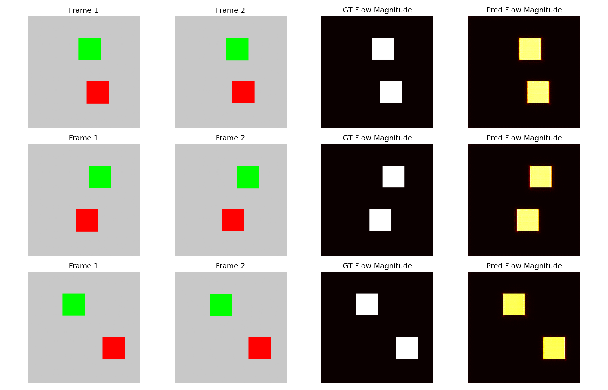

# Optical Flow Estimation

Convolutional neural network for estimating motion (optical flow) between
consecutive video frames. Applications: motion detection, video compression,
autonomous driving.

<p align="center"><br>
<em>Frame pairs, ground-truth flow magnitude and predicted flow magnitude.</em></p>

**Data note:** this project uses a small procedurally generated (synthetic) dataset built in `src/dataset.py` (200 frame pairs of squares moving with a known shift), not real images. It is a didactic implementation: the numbers below show that the pipeline trains, and are not comparable to benchmark results.

## Architecture
Encoder-decoder network: down-sample to extract features, up-sample to
predict per-pixel (dx, dy) flow vectors.

## Installation
```bash
pip install -r requirements.txt
```

## Usage
```bash
python src/train.py
python src/evaluate.py
```

## Results

| Metric | Value |
|---|---|
| Flow MSE, synthetic validation split (final epoch) | 0.0013 |
| Epochs | 15 |

<p align="center"></p>

## Author
Hessam Kaveh — Research Fellow, Italian Institute of Technology

## License

Released under the [MIT License](LICENSE).
