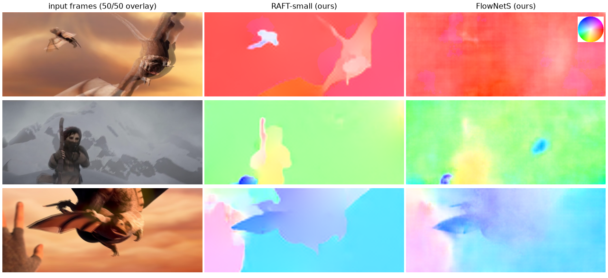
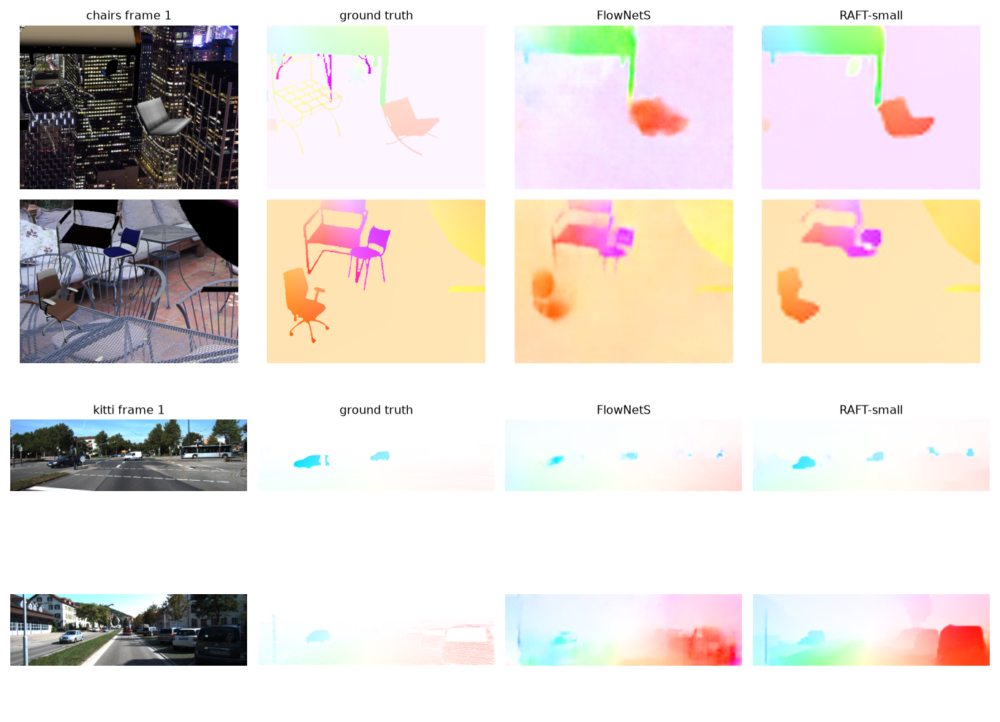
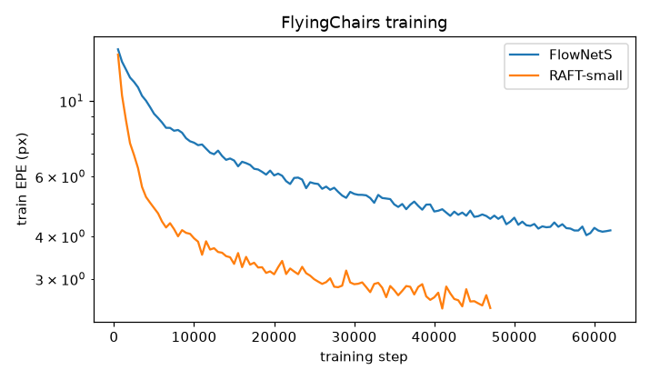

# Optical Flow: FlowNetS vs RAFT, trained from scratch on FlyingChairs

[](https://github.com/HessamKaveh/optical-flow-estimation/actions/workflows/ci.yml)   [](LICENSE)

Two landmark optical-flow architectures are implemented and **trained from scratch** under identical data and augmentation:
- **FlowNetS** (Dosovitskiy et al., ICCV 2015): a U-Net-style encoder–decoder.
- **RAFT-small** (Teed & Deng, ECCV 2020): all-pairs correlation volume + recurrent ConvGRU refinement.

Both are trained on the synthetic **FlyingChairs** dataset and then evaluated **zero-shot on real driving scenes (KITTI-2015)**.

<p align="center"></p>

*Our Chairs-only models on unseen frame pairs from the [Sintel trailer](https://durian.blender.org/) (© Blender Foundation, CC BY 3.0; no ground truth). Colour = direction, saturation = magnitude (one scale per row, wheel inset); RAFT keeps the dragons' shapes where FlowNetS blurs them.*

## Results

| Model | Training data | Chairs val EPE ↓ | KITTI-15 EPE ↓ | KITTI-15 Fl-all ↓ |
|---|---|---|---|---|
| FlowNetS (ours) | Chairs, 62k steps, 1.9 h | 3.35 | 21.27 | 60.9 % |
| **RAFT-small (ours)** | Chairs, 47k steps, 3.0 h | **2.10** | **13.27** | **43.0 %** |
| RAFT-small, torchvision weights | Chairs + Things | 2.04 | 7.59 | 25.2 % |
| RAFT-large, torchvision weights | Chairs + Things | 1.16 | 4.51 | 16.1 % |

*EPE = mean end-point error in pixels. Fl-all = % of pixels with error > 3 px and > 5 % of the true magnitude. The torchvision rows are external references trained on more data, evaluated with the same code.*

<p align="center"></p>

*Top: FlyingChairs validation. Bottom: KITTI-2015 (never seen in training; the ground truth is sparse LiDAR). Colour = flow direction, saturation = magnitude.*

**Findings:**
- **RAFT beats FlowNetS on every metric** (−37 % Chairs EPE, −38 % KITTI EPE), on a smaller step budget. Its 4D correlation volume and iterative refinement are a much stronger inductive bias than a single-pass encoder–decoder.
- **Our RAFT-small matches the official weights on FlyingChairs** (2.10 vs 2.04 EPE), which suggests the reimplementation and training loop are sound.
- **Synthetic-to-real generalisation is the real gap.** On KITTI, the official weights are much better (7.6 vs 13.3 EPE) because they were further trained on FlyingThings3D, which has 3D motion, larger displacements and more realistic scenes. Chairs alone gives no examples of the large forward motion and road texture seen in driving. In the KITTI examples above, both models get the cars right but struggle with the road surface close to the camera, where the displacements are largest.
- Evaluation sanity check: the official RAFT-large C+T weights reach KITTI-15 EPE 4.5 / Fl-all 16.1 % with our evaluation code, in line with the ~5.0 / 17.4 % reported in the RAFT paper.

<p align="center"></p>

## Method

| | FlowNetS | RAFT-small |
|---|---|---|
| Architecture | 10-layer conv encoder (6-channel stacked input), deconv decoder with 5 flow predictions (flow / 20) | torchvision RAFT-small architecture, **random init** (no pretrained weights) |
| Loss | multi-scale EPE, weights 0.32 / 0.08 / 0.02 / 0.01 / 0.005 | L1 sequence loss over 12 refinement iterations, γ = 0.8 |
| Input crop | 320×448 (H, W must be multiples of 64) | 368×496 |
| Batch / lr | 8 / 1e-4 | 3 / 4e-4 |
| Test | input resized to a multiple of 64, flow rescaled | 24 refinement iterations, padded to a multiple of 8 |

Shared settings: AdamW (wd 1e-4), one-cycle linear schedule, bf16 autocast, gradient clipping at 1.0, and a fixed wall-clock budget (`--hours`) that measures throughput first and picks the step count. The augmentation follows RAFT:
- the same colour jitter on both frames;
- random rescale 2^U(−0.1, 0.6);
- horizontal flip (p = 0.5) and vertical flip (p = 0.1);
- random crop.

Hardware: a single laptop RTX 500 Ada (4 GB).

## Datasets

- **[FlyingChairs](https://lmb.informatik.uni-freiburg.de/resources/datasets/FlyingChairs.en.html)**: 22,872 synthetic pairs with dense ground truth. The official `FlyingChairs_train_val.txt` split gives 22,232 train / 640 val pairs.
- **[KITTI-2015](https://www.cvlibs.net/datasets/kitti/eval_scene_flow.php?benchmark=flow)** training set: 200 real driving pairs with sparse ground truth (`flow_occ`). Used only for evaluation.

```
$FLOW_ROOT/flyingchairs/FlyingChairs_release/data/*.ppm, *.flo
$FLOW_ROOT/flyingchairs/FlyingChairs_train_val.txt
$FLOW_ROOT/kitti/training/{image_2,flow_occ}/
```

## Usage

```bash
pip install -r requirements.txt
export FLOW_ROOT=/path/to/datasets
python src/train.py --model raft_small --batch 3 --hours 3
python src/train.py --model flownets   --batch 8 --hours 1.25   # or --steps N
python src/evaluate.py      # Chairs val + KITTI-15, both models + torchvision references, figures
```

## Repository layout

```
src/datasets.py   FlyingChairs / KITTI-2015 loaders, .flo and KITTI PNG readers, augmentation
src/models.py     FlowNetS (from scratch) and RAFT-small wrapper
src/train.py      training loop (multi-scale / sequence loss, time budget, resume)
src/evaluate.py   EPE and Fl-all, flow visualisations, training curves
results/          metrics.json, training histories, figures
```

## Author
Hessam Kaveh — Research Fellow, Italian Institute of Technology (IIT)

## License

Released under the [MIT License](LICENSE).
